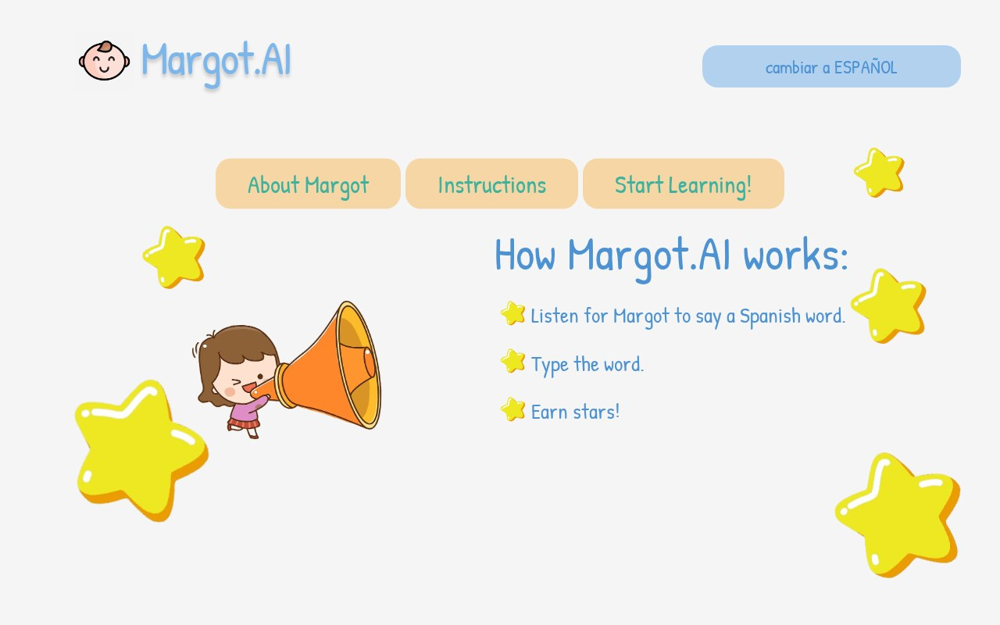
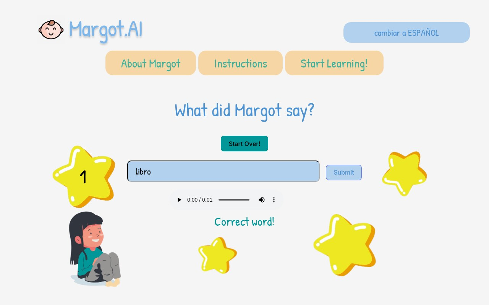
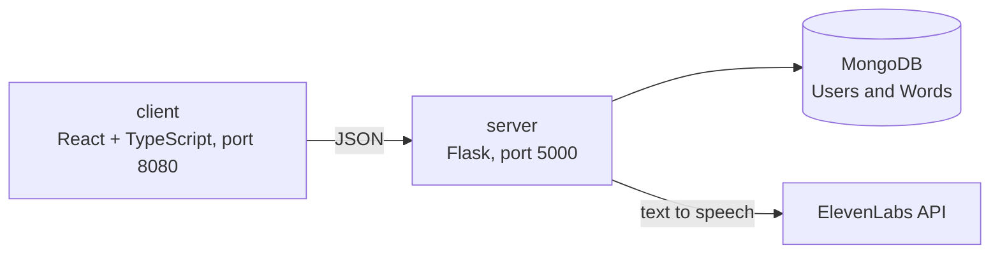

<div align="center">

# Margot.AI

**A bilingual word game for kids learning Spanish or English.**


</div>

Margot says a word out loud in one language, and the child types it in the language they're learning. A right answer earns a star, a wrong one gets a gentle "try again".

Margot dice una palabra en un idioma y el niño la escribe en el idioma que está aprendiendo. Cada respuesta correcta gana una estrella.

| How it works | Practice |
|---|---|
|  |  |

## How to play

1. Pick the language you speak: English or Español. The whole page switches with it.
2. Press **Start**. Margot says a word in the other language.
3. Type what she said in the language you're learning and send it.
4. A right answer adds a star and moves to the next word. A wrong one asks you to try again. Words come in random order and don't repeat until you've been through the whole list.

## How it's built



- **Client** (`client/`): a React and TypeScript app built with Vite, with hand-written CSS. One page with two tabs, About Margot and the practice screen, in both languages.
- **Server** (`server/`): a small Flask API. It reads the word list and the users from MongoDB through mongoengine, and asks ElevenLabs text-to-speech for the audio of each word, in English or Spanish.
- **Data**: two collections. `Words` holds pairs (`english`, `spanish`), and `Users` holds sign-ins.
- **Docker**: each side has its own Dockerfile, and one compose file starts both.

## Run it

You need Docker, a MongoDB connection string and an ElevenLabs API key.

1. Create `server/.env`:

   ```
   MONGODB=<your MongoDB connection string>
   ELEVENLABS_URL=<the ElevenLabs text-to-speech endpoint for the voice you want>
   XI_API_KEY=<your ElevenLabs API key>
   ```

2. Add a few word pairs to the `Words` collection of a database named `MargotAI`, for example `{"english": "house", "spanish": "casa"}`.

3. Start both services from the repo root:

   ```bash
   docker compose up --build
   ```

4. Open `http://localhost:8080`.

To work on one side alone:

```bash
# client
cd client && npm install && npm run dev

# server
cd server && pip install -r requirements.txt && python src/base.py
```

## API

| Method | Path | What it does |
|---|---|---|
| POST | `/login` | Sign in |
| GET | `/users` | List users |
| GET | `/words` | The word list |
| POST | `/generate_audio`, `/load_audio` | Create and fetch the audio for an English word |
| POST | `/generar_audio`, `/cargar_audio` | The same for a Spanish word |

## Project layout

```
client/            React + TypeScript app (Vite)
  src/App.tsx      the whole game: tabs, language switch, answers, stars
  src/assets/      illustrations
server/            Flask API
  src/base.py      routes and the ElevenLabs calls
  src/schema.py    MongoDB models (Users, Words)
docker-compose.yaml
```

## Team

Built by a team of three at a hackathon in October 2023: Gabriel Parra, Pharit Smitasin and Maria ([isunsetglow](https://github.com/isunsetglow)). My part was the MongoDB side (connection, schema, getting data in and out), the ElevenLabs connection and training Margot's voice model, and work across the Flask API and the React client.

## Status

A hackathon project, lightly tidied since (the layout now holds up on phones and tablets). It isn't being developed further. It has no hosted demo, since it needs MongoDB and ElevenLabs credentials to run.
