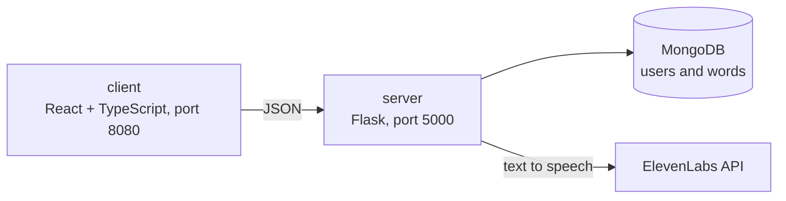

# Margot.AI

A bilingual word game for kids learning Spanish or English. Margot says a word out loud in one language, and you type it in the language you're learning. She tells you whether you got it right.

Ayuda a tus niños a aprender inglés o español jugando: Margot dice una palabra y tú la escribes en el idioma que estás aprendiendo.

## How it works

- The **client** is a React and TypeScript app (Vite) with a landing page and the learning page.
- The **server** is a small Flask API. It keeps users and the word list in MongoDB (through mongoengine) and asks ElevenLabs text-to-speech for the audio of each word, in English or Spanish.
- Both run in Docker with one compose file.



## Run it

You need Docker, a MongoDB connection string and an ElevenLabs API key.

1. Create `server/.env`:

   ```
   MONGODB=<your MongoDB connection string>
   ELEVENLABS_URL=<the ElevenLabs text-to-speech endpoint for the voice you want>
   XI_API_KEY=<your ElevenLabs API key>
   ```

2. Start both services from the repo root:

   ```bash
   docker compose up --build
   ```

3. Open `http://localhost:8080`.

To work on the client alone, run `npm install` and `npm run dev` inside `client/`. The server on its own is `pip install -r requirements.txt` and `python src/base.py` inside `server/`.

## API

| Method | Path | What it does |
|---|---|---|
| POST | `/login` | Sign in |
| GET | `/users` | List users |
| GET | `/words` | The word list |
| POST | `/generate_audio`, `/load_audio` | Create and fetch the audio for an English word |
| POST | `/generar_audio`, `/cargar_audio` | The same for a Spanish word |

## Team

Built by a team of four in October 2023: Gabriel Parra, Pharit Smitasin, isunsetglow and Maria. My part was the MongoDB side (connection, schema, getting data in and out) and work across the Flask API and the React client.

## Status

A finished team project that isn't being developed further. It needs your own MongoDB and ElevenLabs credentials to run.
